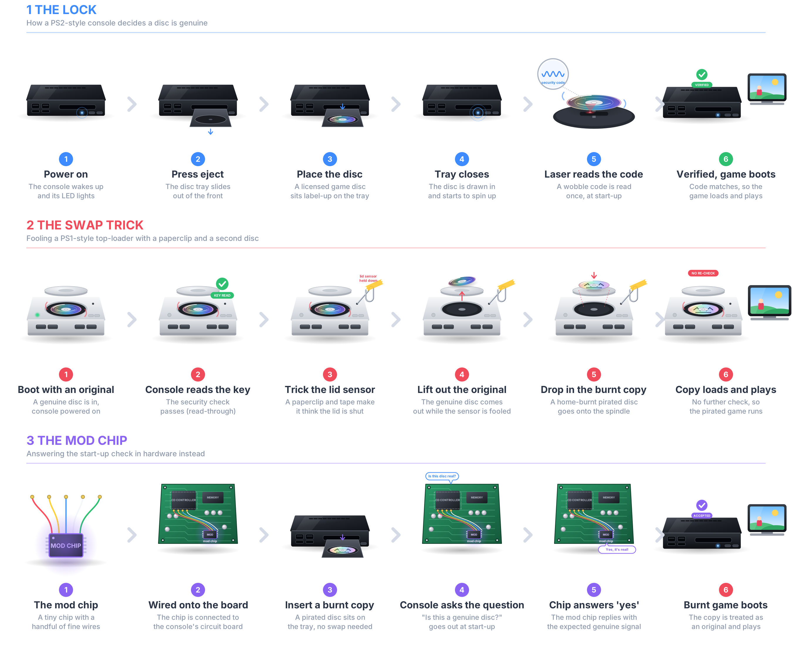

Ever wondered what happens when a game launches? Many of us have seen those flashy trailers, E3 video game expos, and extended previews. But what often goes under our radar is the effort to prevent unauthorised tampering. When you build and launch a “video game or an Intellectual Property”, you make sure those who pay and understand the efforts and resources used in the creation, are the first and only ones to actually experience it, thus having the “Digital Rights or Licence" for the product. That’s all the fancy legal lingo here. What is done behind the scenes then? How is piracy of these “IPs” prevented, especially during the launch days? They use software for **“obfuscation”** and **“anti tamper protection"**.

Pirates and Publishers have engaged in a long Arms Race since the dawn of video games. Prominently since the start of the world wide web. Early ways to avoid tampering were to enable the legalised access of video game discs of PlayStation 1 and 2 through the use of embedded security codes on discs. The sensors on the consoles would read through the code when the disc was loaded initially and then would allow the game to boot normally. Pirates cleverly used a “paperclip or tape" to trick the sensor and fool the authentication or “read through” process. They would boot the console with an authentic original copy of a video game so the console could read its security key and would then simply swap the disc with a burnt pirated one before the game data was loaded. Later, mod chips were directly embedded on BIOS to intercept the security startup query and just treat the burnt game as an original one. Emulators like PCSX2 and torrenting through PirateBay, Kickass.to and Rarbg slowly became popular, which simply released cracked ISO and ROM files for these “exclusive” PlayStation releases.

This brings us to the key idea **“Find something which the system trusts, and make sure it trusts something else.”** Steam launched around 2003, and so did their DRM policy. For newbies, Steam is an online retail platform for buying video game access through “Digital Licences”. It verifies purchases and licences for a user through certain additional DLL files and wrappers around the game’s executable to verify the ownership and obfuscate the “.exe” file’s binary code. A simple check involving code which involves function calls to the Steamworks API, leading to Steam AppID verification with the concerned account triggered during the launch sequence with the local Steam client. To counter this, Pirates simply use tools like Steamless to strip away the initial Steam Stub encryption and then use custom DLL files to mimic the Steam API. This creates a “Fake Response” scenario; when the game boots up, the fake DLL intercepts the call locally and returns a “False Positive”. There have been upgrades to Steam’s DRM and so to the ways for countering it.

Crackers and Repackers have their own separate role to play in this ecosystem of evolving mechanisms of publishers. Crackers like PROPHET, CPY and Reloaded try to be the first one to possibly crack a video game release. All these anonymous weirdos would try their best to crack the defences set up by publishers to create a working executable free for anyone to use. A game crack is technically a software or local repository of multiple lines of code and types of files of a game’s build without the locks added by developers. Repackers like Dodi, Elamigos, and Fitgirl, on the other hand, are the ones who use their wits and tools like SREP for exploiting similar data, FreeArc for compression, and InnoSetup for the installer framework. In the end, creating easily distributable copies and uploading them on their websites. And Pirates? That’s basically us! the general public, who spread these working builds through word of mouth.

This entire ecosystem, however, got a huge setback in 2014 through the entry of “Denuvo DRM by Irdeto”. It simply provided a secure anti tampering and obfuscation layer through the following pipeline. After launching a game executable with Denuvo protection, the OS would load the game’s ".exe" file in memory and execute it simply while enabling Denuvo to set up its protection environment. This includes several code decryption, integrity and modification checks, and preparation of runtime components. The Denuvo protection layer thus increases the time to crack the code. At its core, it's a mere translation of a critical portion of the game’s native machine code into custom bytecode which runs inside an obfuscated virtual machine. This makes the code unreadable and extremely difficult to reverse engineer. Along with this, large sections of the game code and data are encrypted on the storage disc along with Denuvo’s own internal code and cryptographic keys through “White Box Cryptography", preventing any leak of running memory or code. Thus, it would allow the game’s decrypted code to be run as per gameplay if all checks pass, or else, it blocks execution and shows a tampering error if any of the checks fail. It also features “Hardware Binding", which involves the creation of a unique digital fingerprint or ticket as per the computer’s specific components, ensuring only authorised devices run the game. Denuvo constantly changes its code with every update, which proves another issue and increases the time and effort of Pirates. This leads to crackers spending weeks or months to map out these hidden triggers manually. At the cost of this security, gamers pay in the end through bumped up requirements, stutters and crashes.

How did Pirates counter this? There were two choices. First was to simply wait. Although Denuvo seemed to be the solution to all problems, “It is costly!” Publishers have to pay a hefty subscription fee every month. Publishers hence simply use Denuvo in the early days of a release and later slowly remove the protection. That’s when Pirates attack. The second choice was to use reverse engineering tools, primarily NSA’s Ghidra, along with dynamic debuggers like x64dbg and custom scripts. This process was cumbersome to bypass. A few crackers like EMPRESS painstakingly performed static analysis with Ghidra, where the game’s executable would be opened to understand the Denuvo related functions and important checks. Cross references, string and function call graphs provided by Ghidra were used for this work. Along with this, the debugger would observe runtime behaviour, especially custom scripts, providing automation, memory dumps and breakpoints; thus helping in tracking decrypted code and monitoring the system calls for understanding the validation behind. This entire information would be used to modify the code or “patch jumps” which are present in memory or in binary and then neutralise VM handlers. This would finally enable bypassing of anti tamper logic used. Scripts speed up the analysis here through "Pattern Scanning and Auto Patching". In the end, the patches would be used to hook functions with a custom DLL at runtime and return fake or valid values. This in turn would be tested and released as a Denuvo Crack. Some crackers, being fed up with these changes in the ecosystem, instead joined Denuvo’s team and used their experience in helping Denuvo increase its defences.

With every consequent update to Denuvo, the “battlefield was moving downward”. Meaning the entire question about a game’s protection was being shifted repeatedly from executable to the process, then to the OS, and eventually towards virtualisation and the hardware environment underneath. Remember “White Box Cryptography and Hardware Binding"? DenuOwo in 2025 found a bypass in this strategy used by Denuvo and rather used a subtle approach. Use a virtual environment underneath the Windows OS and operate at a lower privilege level than the OS kernel. This enabled emulation of specific CPU instructions and effectively tricks Denuvo into believing “All is Well” through use of hardware generated keys of a device with a known licence. But this led to a critical security flaw. You gave very critical access to a hypervisor which only signed drivers can access. This may kill your entire device, far from simple recovery.

Another recent feat came through Voices38 through his traditional approach. He broke the anti tamper protection by direct debugging, decoding and manual patching of internal licence checks in the game’s executable. This is still kind of time consuming but still is a lot easier than the way EMPRESS did it. Voices38 took a year to release the initial crack. But subsequently the output became much more frequent. In response, Irdeto took legal action against Voices38 and brought the battle into the courtroom and demanded compensation. This led to DenuOwo’s departure from the community in fear of legal threats. Even then, RUNE released a “Proof of Concept” build for AC Mirage, removing around 200 Denuvo VM bodies; resulting in better performance as Denuvo hampered it.

For years, porting console exclusives to PC meant tackling the enormous challenge of emulating the entire environment, thanks to the proprietary console architecture. Prominently, PS3 emulation faced this issue during RPCS3’s attempts due to the infamous Cell Broadband Engine CPU and RSX GPU. Meanwhile, PS4 had an x86-64 CPU running on a FreeBSD based Orbis OS with the GNMX graphics. Thus, the task here for emulators like shadPS4 was to translate these PS4 system calls, shaders and graphics to something Windows compatible which hadn’t received much progress. Supermedo and deadinside28 have leveraged AI tools and taken a targeted approach for porting Bloodborne and God of War 3 individually. The game specific runtime runs directly on the PC’s x86-64 CPU easily and replaces the PS4 system functions as required. The graphics layer translates the console's GPU commands to Vulkan and PS4 shaders to SPIR-V, an IR used by Vulkan, being PC compatible. This enables more optimisations and mods in the end. Judging by this speed, we may be able to play GTA 6 before it comes out for PC “officially”.

So what’s the “Big Picture” then? At its core, it's **“Attack and Defence"**. The defenders build stronger protections, and the attackers find new ways to bypass them. Solving long time problems like Denuvo DRM and console exclusivity is what core reverse engineering aims at as evident from the famous “Reverse Engineer Anything tool Repository”. **“If Buying isn’t Owning, then Piracy ain’t Stealing."** A wide speculation follows this phrase since Sony’s backlash on upcoming physical disc closure. Piracy still remains a vague question to answer. As many of us wouldn’t have been introduced to gaming if we hadn't even played pirated versions of GTA Vice City or San Andreas. This still doesn’t settle this ethical debate but rather makes it more complicated as a question of access, control and ownership.
